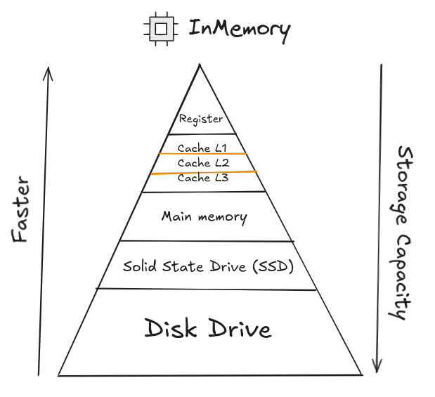
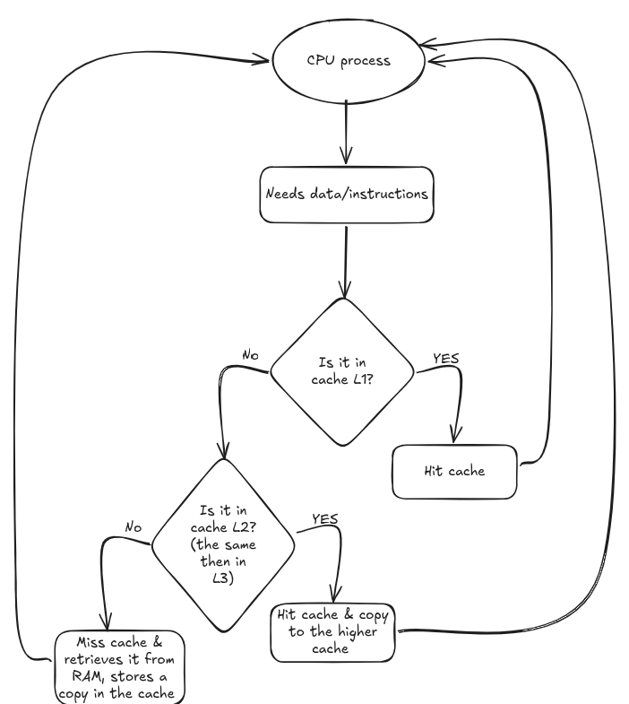
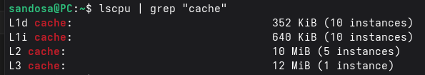

Before Talking about the CPU cache, You have to know the **computer memory hierarchy**. 

This diagram can differ, But we agree that there are fundamental principles. Registers are the fastest and most expensive storage level in the memory hierarchy and the smallest storage capacity, one register can hold one **word** of data, instructions, etc. Then in next lower level -> cache, which we'll talk about in some of detail, then the main memory (DRAM), programs and data that are actively being used are loaded into RAM while the system is running, it's a short term and volatile memory. Then SSD, HDD are the secondary storage "Storage" for storing the data in "things that you can access again after you turn off your device".

## What is the CPU Cache?
Small, high speed memory located on (cache L1) or vary close (cache L2,L3) to the processor cores. Its purpose is to keep frequently accessed data and instructions close to the CPU reducing the need to retrieve them from slower main memory (remember, the RAM is located on the motherboard; which is not near to the CPU).
Cache memory keeps a **ready copy** of the data the CPU is likely to need next, allowing it to continue execution without delay.
## So.. How it works?
Firstly, let's define some of the terms.
- Cache Hit -> If required data is found in the cache and the CPU can use the data immediately.
- Cache Miss -> If the required data is **Not** found in the cache and the processor has to fetch the data from the RAM, and once retrieved, a copy is stored in the cache for future use, which is called a block.
- Block -> The amount of information that is retrieved from the next lower level on a miss.
In usual, The are 3 level of caches L1, L2 and L3.

#### Cache L1
**For:** Immediate data access
**size:** 32 KB - 128 KB per core
**Location:** Inside CPU core
**Access Speed:** ~1 ns
It handles the most frequently accessed data & instructions, and usually be split into:
- **L1i** -> Instruction cache, stores CPU instructions.
- **L1d** -> Data cache, stores values the CPU needs.
#### Cache L2
**For:** Store recently used data
**size:** 256 KB - 1 MB per core
**Location:** Near to CPU core
**Access Speed:** ~3-3.5 ns, Slightly lower than cache L1 ~3-3.5 ns
This layer reduces the number of cache misses that require data to be pulled from RAM.
#### Cache L2
**For:** Coordinates data access
**size:** 4 MB - 64 MB for shared cores
**Location:** Near to CPU cores
**Access Speed:** ~10-17 ns, Lower than cache L1 & L2 
When multiple cores process different threads of the same app., L3 ensures they can access shared data without repeatedly retrieving it from RAM.

> If you wants to know about the CPU caches in your device:

```
#in your terminal
lscpu | grep "cache"
```

