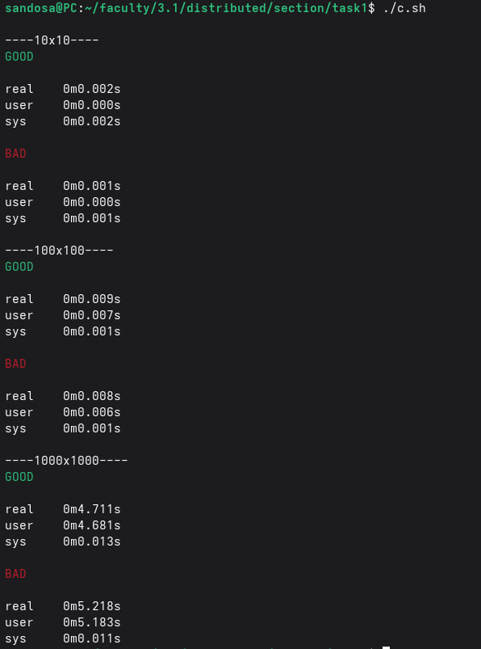
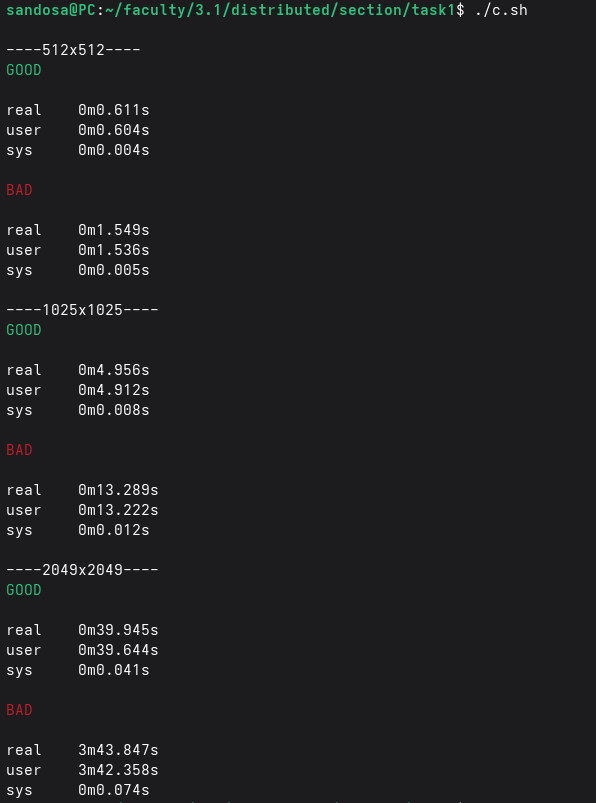

# HPC Matrix Multiplication Cache-Miss Explorer
Report about CPU Cache & Bash script creates good and bad performance in C language.
A Script created for showing how the computer really works, the same algorithm, program lang and compiler for two programs but the one is about 10x speed then another. It's about CACHE MISSING, when caching, do just the data CPU needs is fetched, but also the data addresses are close by will tend to be fetched soon which is called (Spatial Locality). IN C lang, The array is stored in ROWS, so when the CPU fetch the data from the RAM to cache it fetches the other data near to it in the row. This shell script will show you the difference between looping in Row major order & Column major order.

## Get Start
```
# In your terminal
git clone HPC-Cache
cd  HPC-Cache

# Give an execution premission to the script
chmod +x c.sh

# Start
./c.sh
```
> Note: I didn't use number like 10, 100 or any beautiful number, beacuse in many device "as mine" has something called **Hardware Prefetching**, which is a feature in CPU performance and optimize the process even if the compiler doesn't optimize [See the reference](https://www.sciencedirect.com/topics/computer-science/hardware-prefetcher)

 
## Desired Output
As you will see, the time in GOOD one is much smaller than BAD one, that's beacuse of the way we access data.

